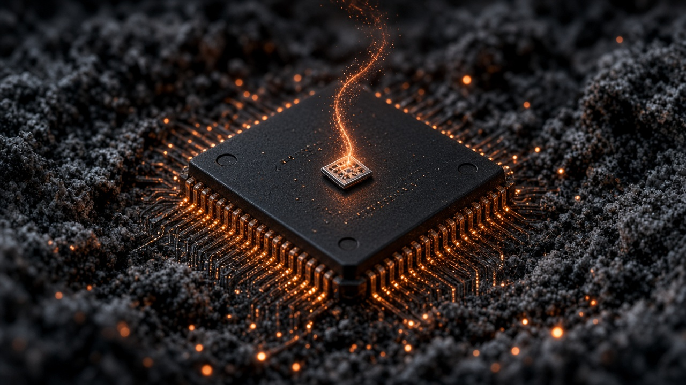

# EmberROM



**EmberROM** — keep the last glow of a vendor ROM, then forge open firmware from it.

Process and tooling to port **vendor laptop BIOS/UEFI** to open firmware ([coreboot](https://www.coreboot.org/) and related stacks), while keeping machines usable on modern Linux along the way. Board work lives under `targets/`; shared process docs live under `docs/process/`.

## First target

| Field | Value |
|-------|--------|
| Board | [Razer Blade Stealth 13 Late 2019](targets/razer-blade-stealth-2019-rz09-03101/) |
| SKU / board | RZ09-03101E72 · **LY320** |
| CPU | Ice Lake i7-1065G7 |
| Stock BIOS | AMI Aptio 2.20.1275 · System BIOS **1.05** · EC **1.01** · ME **13.0.46.1718** |
| SPI | Winbond W25Q128.V 16 MiB — [FLASH.md](targets/razer-blade-stealth-2019-rz09-03101/FLASH.md) |
| Goal OS | [CachyOS](https://cachyos.org/) (Ubuntu on unit is temporary) |
| Known stock bug | **Suspend / sleep broken** |
| Port bar | coreboot **feature parity** (P0 daily driver) — [GOALS.md](targets/razer-blade-stealth-2019-rz09-03101/GOALS.md) |

Razer hub: [Answer 4566](https://mysupport.razer.com/app/answers/detail/a_id/4566). Live capture: [INVENTORY.md](targets/razer-blade-stealth-2019-rz09-03101/INVENTORY.md).

There is **no** flashable open BIOS yet. Stock suspend workarounds and coreboot port run in parallel — see [TASKS.md](TASKS.md).

## Process

```text
inventory → dump SPI → extract/analyze → keep usable (stock) → port (coreboot) → flash → recover
```

| Stage | Doc |
|-------|-----|
| Safety | [docs/process/safety.md](docs/process/safety.md) |
| Inventory | [docs/process/inventory.md](docs/process/inventory.md) |
| Dump | [docs/process/dump.md](docs/process/dump.md) |
| Extract | [docs/process/extract.md](docs/process/extract.md) |
| Stock enablement | [docs/process/stock-enablement.md](docs/process/stock-enablement.md) |
| Port | [docs/process/port.md](docs/process/port.md) |
| Flash & recover | [docs/process/flash-recover.md](docs/process/flash-recover.md) |
| Add a target | [docs/process/add-target.md](docs/process/add-target.md) |

## Layout

```text
emberrom/
  docs/process/     # board-agnostic workflow
  docs/assets/      # heroes, photos (no ROM binaries)
  targets/<board>/  # per-laptop notes, status, vendor links
  tools/            # shared helpers (later)
  vendor/           # local proprietary updaters (gitignored)
  dumps/            # local SPI dumps (gitignored)
```

## Principles

- **Freedom-respecting** — prefer open firmware and user-controlled boot paths when the silicon allows.
- **Recoverable** — no experimental write without a verified dump and an external flash plan.
- **No blob redistribution** — document hashes and download steps; keep ME/BIOS/EC images local.
- **Maintainable** — one shared process; targets carry only board-specific truth.

## Related prior art

- [coreboot](https://www.coreboot.org/) / [Libreboot](https://libreboot.org/) (supported boards only)
- EmberROM WIP fork: [DataKnifeAI/coreboot](https://github.com/DataKnifeAI/coreboot) (`emberrom/icelake` — Ice Lake revive + Blade board; upstream via Gerrit, not GitHub PRs)
- Abandoned Ice Lake Stealth work: [coreboot CL 37565](https://review.coreboot.org/c/coreboot/+/37565)
- Ice Lake removed from mainline: [CL 72008](https://review.coreboot.org/c/coreboot/+/72008)

## License

Apache License 2.0 — see [LICENSE](LICENSE).

coreboot patches contributed upstream remain under coreboot’s license (GPL-2.0). Vendor firmware stays proprietary and is not redistributed from this repository.

Maintained by [DataKnifeAI](https://github.com/DataKnifeAI).
